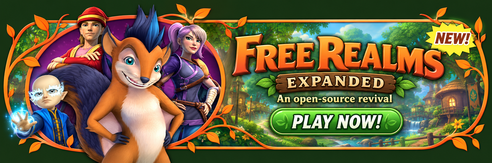

<p align="center">
  
</p>

<h3 align="center">An open-source revival of Free Realms, with tools to build new content in the running game.</h3>

<p align="center">
  <a href="#whats-new">What's new</a> ·
  <a href="ROADMAP.md">What still needs doing</a> ·
  <a href="#what-this-repository-contains">What's in this repo</a> ·
  <a href="#getting-started">Getting started</a> ·
  <a href="#credits">Credits</a>
</p>

---

**Free Realms Expanded** brings back Sony Online Entertainment's 2009 family MMO, which shut down in 2014. It has two parts:

- **A new server written in Rust.** The original Windows client connects to it unmodified and plays as if the official servers were back.
- **A toolkit for building new content inside the running game.** You can walk the world, place NPCs and run live events, and what you build is saved.

The goal is not only to restore Free Realms but to let the community **expand** it, filling the gaps the original server left with new quests, dungeons, NPCs and events.

> **Unofficial fan project.** Free Realms Expanded is a non-commercial fan project. It is not affiliated with, endorsed by or sponsored by Daybreak Game Company or Sony.
>
> **Status:** active development. The original client plays real content against our server on a developer's machine today. There is no public server yet.
>
> **What still needs doing:** see [ROADMAP.md](ROADMAP.md). It explains each unfinished area in depth, lists the bugs found in the latest real-client test, and says how you can help.

## What's new

About 750 changes landed between 10 and 26 October 2026. Here is the current build, grouped by area. Two labels are used throughout:

- **Seen in the real client:** someone ran the original Windows client against our server and watched it work.
- **Tests only:** automated tests or our scripted test player exercised it, but nobody has watched it in the real client yet. Treat these as "should work", not "works".

Details on what is still missing in each area are in [ROADMAP.md](ROADMAP.md).

### Combat and balance

- **Tests only:** combat numbers now come from one data table that can be edited while the server runs: basic damage per job, five damage tiers (unlocked at levels 1, 4, 8, 12 and 16, each about 1.75 times the one before), player health growth, and enemy health and damage scales. They are fitted to the final-era figures on the wiki and to reviewed gameplay video. Any number we had to fit ourselves is marked as reconstructed. Enemy health was refitted on 26 October to match how many hits enemies took in video.
- **Seen in the real client:** the level-1 health bar shows the new base value (500). Earlier checks also covered *Troll Summoner Madness!* from start to finish, level-locked Medic abilities, and power-up pickups that drop, can be collected, and disappear after 30 seconds.
- **Tests only:** all six combat jobs (Brawler, Archer, Medic, Ninja, Warrior and Wizard) have basic attacks, level-locked abilities and equipped-weapon checks. Free-roaming enemy camps cover levels 1 to 20, and eleven field battles run end to end, including Bixie Hive, Sheep Watch, Bandit Hideout and King of the Ring. Kills pay coins, job XP and per-player pickups. When a grouped player starts a battle, the other members get the original invite. Paid revive from the knockout window works.

### Pets

- **Tests only:** every pet and Pet Pal item in the client's data can be adopted (113 pet types, each with its model, vanity flag and trick list). Pets follow their owner, snap to the ground, catch up or warp when left behind, and dance beside an owner who is dancing. The care panel takes feeding, watering and grooming items, and the Pet Browser record carries each pet's real icon, name, tint, tricks and clothing classes.
- **Known gap:** in the last real-client test, bought or granted pets did not show up in the bag or the Pets window, so none of the above could be watched. See [ROADMAP.md](ROADMAP.md).

### The Card Duelist card game

- **Tests only:** the card game was a separate online service in the original, so the server now speaks that service's login and gateway protocol (worked out from the client's own card module) and checks one-time launch tickets. The card-game entries appear in the Games window, and two Card Duelist quests are bound to their original records.
- **Not built:** the card game itself. No duels can be played yet.

### Housing

- **Seen in the real client:** every new character owns the Wilds Condo starter lot. My Houses lists it, you can walk in and out, and Click to Decorate opens with a drawn preview of the chosen item.
- **Tests only:** placing and picking up furniture (the client refused the placements we tried), visiting other players' houses, buying house lots in the Marketplace, and a table of 1,186 placeable fixtures. 23 lot definitions are switched on; the rest wait for scene files we cannot match yet.

### Minigames and activities

- **Seen in the real client:** you can start a kart race from a driver NPC at the portal areas, and an earlier three-lap race paid coins and XP once. A boombox put on the item bar places a box that plays its song and tints to match, and your character dances (15 client boomboxes are defined; the Rainbow Randomizer was the one tested). Two world radios play and make you dance. Reconnecting after leaving a mining game midway works cleanly.
- **Tests only:** nearby players dancing in step to a boombox, demolition derby (four arena drivers open a real match), Soccer Star (a trainer and a Snowhill match), chess (rewards need a properly played game), harvesting and mining nodes, sparkling collection nodes, exploration coins and collection rewards, and a Go fish! trip into a fishing hole's own scene.

### Marketplace and Station Cash

- **Tests only:** Station Cash is earned in play (finishing races, matches, dungeons and quests) and kept per character. The Marketplace sells rides in sub-categories (winged, non-winged, exotic, mechanical), boomboxes and house lots. It refuses a second copy of a ride you own. Shops sell back at one tenth of the buy price, and refuse items the server cannot yet make work. There are 89 ride definitions; a ride takes the texture and tint of the item you own, and a Training Saddle upgrades a winged ride for gliding.
- **Seen in the real client:** the Boombox category shows names, icons, descriptions and the right prices. Known gaps: the "Sort By" menu and the Hot Items category.

### Quests, NPCs and dialog

- **Seen in the real client:** quest offer, accept, tracker pin, talk objectives, and the quest goal text. NPCs tied to an enabled quest greet you with a line recovered from the client's own text.
- **Tests only:** about 94 quests are switched on out of 678 quest records, across the job lines (Warrior, Wizard, Medic, Archer, Brawler, Ninja, Miner, Chef and others) and several regions. Objectives can be talk, kill, collect, gather, craft, visit a place, finish a minigame or dungeon, or reach a job level. Quest markers over NPCs, the Job Browser's quest list, and idle and emote animations for townsfolk, critters and children are in too. Several hundred NPCs were drawn from community spawn lists.

### Travel and zones

- **Seen in the real client:** the Atlas lists the warpstones you have attuned to, you attune by walking up to one, travel works, Teleport to Safety works, and attunements survive a relog.
- **Tests only:** a shared table of the client's ten regions and named places with a position-to-region lookup (the groundwork for the "Now entering" banner), recovery of a character saved off the map, and an admin command to move a stuck character.

### Events and seasons

- **Seen in the real client:** the Vampires vs Werewolves dance-off kicks off on its schedule in Blackspore, with dancers, taunts and the pumpkin prince.
- **Tests only:** an event system where NPCs spawn, move, speak, broadcast and leave on a timeline and a wall-clock schedule, gated by season. It runs Bruce's concert (alternating between the Snowhill and Wugachug stages every two hours) and the dance-off (every 30 minutes in season), plus yearly season windows and Halloween decorations that only show in season. An admin can open and close the scavenger hunt.

### Accounts, login and safety

- **Seen in the real client:** a brand-new account can go through the character creator, enter the world, and add more characters (members get three slots; new accounts are members by default). Players are refused developer commands that their role does not allow.
- **Tests only:** login uses key pairs instead of passwords. The launcher keeps a private key per server, the server stores only the public key and checks a signed challenge, and a one-time 60-second token is handed to the client. Our test player has logged in this way over a private network address. Accounts have roles (player, builder, admin, moderator), and moderators can mute, kick and ban. Per-account rate limits, connection caps and hardened packet handling are in place, and a fault in one player's session ends only that session.

### Under the hood

- Gameplay values live in data tables you can reload while the server runs, features live in their own modules, and size limits keep the central files thin. A shared field that nobody is standing in goes to sleep. The test suite was audited and sped up.

## Building new content

Building an MMO's worth of content takes good tools. The server includes a developer **Studio**: a local web page plus in-game chat commands.

- **Live:** your character, nearby actors, and one-click commands (`level`, `heal`, `god`, `battle`, `win`).
- **Map:** a shaded relief map of the world built from the client's terrain. Click to teleport onto the ground, or click to place an NPC.
- **Content:** edit battles, enemies, abilities, quests and NPCs as tables, then hot-reload them without restarting.
- **Inspector:** a graph of how the game's files connect (items, models, effects, animations and abilities).
- **Fight:** a balance simulator per job and level, plus a fight log.
- **Packets, Saves, Report, Client log:** a live message inspector with send, save states, a content checker, and the client's own errors.
- **Bot client:** a scripted player for automated end-to-end tests, such as logging in, entering a battle arena and winning.

**World Builder** (in progress) lets trusted builders place NPCs and exploration coins in the running world, start and stop live events, and persist what they build. Placing NPCs and starting events are in place. Quest authoring and a review step for finished content are still planned. Design: [World Builder](notes/Design/World%20Builder.md) and [Studio Toolkit](notes/Design/Studio%20Toolkit.md).

## What this repository contains

- **Our server code, tools and notes.** The Rust server, the Studio, the scripts and the design notes are our own work. Community projects were read as references while building it (see [Credits](#credits)).
- **Gameplay data.** `prototype/osfr-tools/data/content` holds NPC tables, quests, stores, vendors, pets, rides and more as JSON. It was built from the original client's data files, so it includes quoted in-game text such as item names, dialog lines and quest text. Some rows were derived from community projects (FreeRealms-Legacy and Sanctuary) and from the Free Realms Wiki, and each row's provenance fields say where it came from. Numbers we had to invent are marked **(R)**, for reconstructed.
- **Notes on how the client works.** The notes under [notes/Native Map](notes/Native%20Map/Native%20Map.md) and [notes/Build Guides](notes/Build%20Guides/Build%20Guides.md) are our own descriptions of how the original client behaves.
- **What it does not contain:** no game binaries, no asset packs and no extracted art. You need your own legally obtained copy of the original client to play.
- **Old copy of the launcher.** The `launcher/` folder is a previous copy, kept for now and due to be removed. See [Launcher](#launcher).

```text
prototype/osfr-tools/   Rust server: gateway, login, encounter engine, quest engine, Studio, bot, terrain
  src/bin/              osfr-gateway, osfr-login, osfr-account, osfr-bot, osfr-terrain
  data/content/         Gameplay content as JSON: NPCs, quests, stores, pets, rides, battles, abilities
  studio/               Studio web page (served by the gateway with --dev-tools)
scripts/                Content checker, data builders, test bundles, stress harness, research tools
notes/                  Design and research notes (open in Obsidian, or read as Markdown)
tests/                  Python checks for scripts and coverage
launcher/               Old launcher copy (see below)
```

## Launcher

The launcher now lives in its own repository: <https://github.com/FadedSociety/free-realms-launcher>. The `launcher/` folder here is the old copy and will be removed.

## Getting started

Running a server from a bare checkout is not possible yet. The game server needs a startup snapshot and several reference packages prepared from the original client and from captured game traffic, and those are not in this repository. A reproducible setup for contributors is on the [roadmap](ROADMAP.md). To run the original client you also need your own copy of it.

What you can do today is read the code, data and notes, and build and test the server with a current stable Rust (the crate uses edition 2024). It is developed on Windows with the `x86_64-pc-windows-gnu` toolchain. Other platforms have not been tried.

```text
cargo build --release --manifest-path prototype/osfr-tools/Cargo.toml
cargo test --manifest-path prototype/osfr-tools/Cargo.toml --no-fail-fast
```

A few things to know:

- `scripts/cargo.ps1` is the maintainers' wrapper. It points at a toolchain folder that sits beside the repository, which you will not have. Plain `cargo` works instead.
- The first build is slow, and a full test run takes about ten minutes. A test build folder can reach tens of gigabytes; setting `CARGO_PROFILE_DEV_DEBUG=0` and deleting its `debug` folder afterwards keeps that down.
- Tests that need the private reference data are marked as ignored. We have not yet confirmed that a bare checkout runs the whole suite cleanly.
- For how the maintainers run a private test realm, see the [Playtest Host Runbook](notes/Design/Playtest%20Host%20Runbook.md). It assumes the private data.
- For where each piece of the code lives, see the [Project Map](notes/Project%20Map.md). Its layout is accurate, but it was last refreshed in mid-October.

## Project principles

- **The client is the source of truth.** Behaviour comes from what the original client sends, expects and displays. We map the client function by function and cross-check the map against a disassembler. Fan wiki and community emulator data are used only where the client is silent, and the client wins when they disagree.
- **Reconstructions are marked.** No original server code survives, so every server rule we had to invent (balance, drop tables, enemy behaviour, prices) is tagged **(R)** in code, data and notes.
- **Native acceptance.** A feature is done only when it works in the original client. "Tests pass" is not enough, which is why this page says which features have been seen in the real client.
- **Numbers are data.** Gameplay values live in data tables that can be changed and reloaded while the server runs. Tests check sane bounds rather than pinning exact values.
- **Community projects are references.** The server code is our own. We read community projects to understand the game, and where we took data rows from them, the row says so.

## Documentation

- [Roadmap](ROADMAP.md): what still needs doing, known bugs, and how to help
- [Build Plan](notes/Design/Build%20Plan.md) and [Build Ledger](notes/Design/Build%20Ledger.md): the working plan and the per-system status. Both were last refreshed in mid-October, so this page and the roadmap are newer.
- [Security Model](notes/Design/Security%20Model.md) and [Public Transport](notes/Design/Public%20Transport.md): how login and networking are meant to be secured
- [Studio Toolkit](notes/Design/Studio%20Toolkit.md) and [World Builder](notes/Design/World%20Builder.md)
- [Build Guides](notes/Build%20Guides/Build%20Guides.md): one guide per game system, built from the client map
- [Project journal](MODLOG.md)

## Credits

Free Realms Expanded stands on the work of the Free Realms community.

- **Sanctuary**, the community Free Realms server project. We read it as a reference, and some data rows derive from it.
- **FreeRealms-Legacy**, the community Free Realms server project. We read it as a reference, and some data rows derive from it. (Sanctuary and FreeRealms-Legacy are AGPL-licensed.)
- **FreeRealmsLocaleTools**, community tools for the client's locale files, which we use unchanged to build text packs.
- **fr-adr-toolkit**, community tools for the client's actor and model files, used to check our asset reading.
- **The Free Realms Wiki on Fandom.** Some prices, quest facts and achievement text were collected from it. Its text is available under CC BY-SA.

Thank you to everyone who kept the game alive after 2014.

## Licence

A licence has not been chosen yet.

## Legal

Free Realms Expanded is a **non-commercial fan project**. It is not affiliated with, endorsed by or sponsored by Daybreak Game Company or Sony. Free Realms and related names are trademarks of their respective owners. This repository contains no game binaries, asset packs or extracted art; it contains our own code, tools and notes, plus gameplay data built from the client's data files and community projects as described above.
